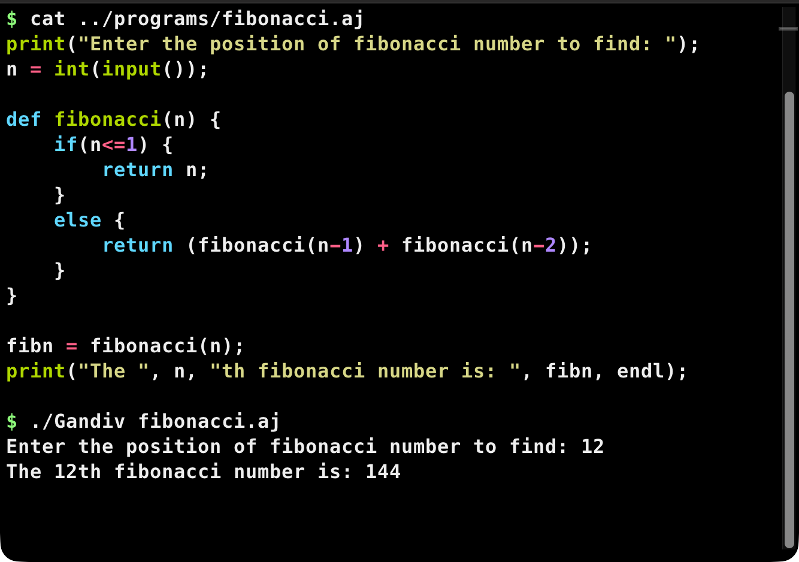
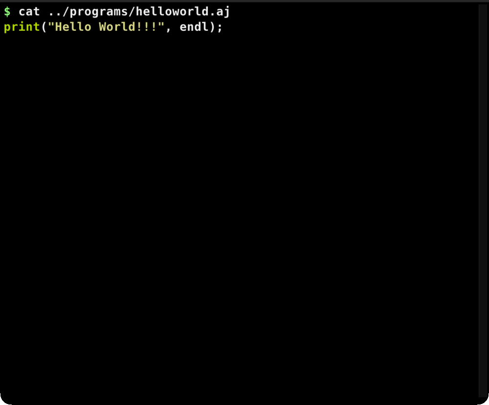
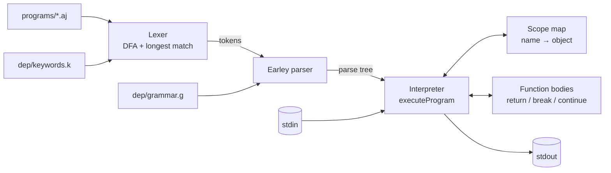

# Gandiv

A small interpreter for a dynamically typed language — a hand-written DFA lexer, an Earley parser, and a tree-walking evaluator in about 800 lines of C++14.

[](#tech-stack)
[](#quick-start)
[](#license)

## Features

- **Data-driven front end.** The lexer builds its DFA at startup from `dep/keywords.k`; the parser reads `dep/grammar.g` at runtime. Change either file and re-run — no rebuild.
- **Real Earley parser.** Predict / complete / scan over the grammar, producing a parse tree instead of a hard-coded recursive-descent tree.
- **Tree-walking evaluator** with six value kinds: `int`, `real`, `bool`, `string`, `function`, `void`.
- **Control flow**: `if` / `else`, `while`, C-style `for`, counted `for i = a to b`, `break`, `continue`.
- **Functions and recursion.** `def fibonacci(n) { ... }` works; `programs/fibonacci.aj` recurses to compute the n-th term.
- **Runtime type checking** with line numbers. Bad operands and missing variables exit with a readable message, not a crash.
- **Zero dependencies.** C++14 and the standard library only; one CMake target.

## Language at a glance

```gandiv
print("Enter a number: ");
n = int(input());

sum = 0;
for i = 1 to n {
    sum = sum + i;
}
print("sum = ", sum, endl);

def square(x) {
    return x * x;
}
print("square = ", square(n), endl);
```

Values are dynamically typed. `print` takes any number of values and does not insert spaces, so the string literals carry their own. `endl` starts a new line.

## Showcase



*`programs/fibonacci.aj` above, then a real run: the input `12` produces `144`.*



*A real terminal session: the source of `helloworld.aj`, `fibonacci.aj` and `primefact.aj` is printed with `cat`, then each file is executed by `./Gandiv`. The GIF is a sequence of stills captured from an iTerm2 window at each settled state — every command and every line of output is real.*

> Gandiv is a file interpreter, not a REPL: `./Gandiv <file.aj>`.

## Architecture



The pipeline in `src/main.cpp:14-16` is only three calls:

1. `Lexer::tokenize(filename)` opens `../programs/<filename>`, builds the DFA from `../dep/keywords.k`, and scans each line into tokens carrying `name`, `attribute` and `line_number` (`src/lexer.cpp:78`).
2. `Parser::parse(tokens)` loads `../dep/grammar.g`, runs Earley, and returns a `Node *` parse tree; failures print `Syntax error in line N` and exit (`src/parser.cpp:33`).
3. `Interpreter::executeProgram(root, scope)` walks the tree (`src/interpreter.cpp:19`). Statements dispatch in `executeStatement` (`:127`), values are computed by `evaluateExpression` (`:162`), calls are bound in `executeFunction` (`:319`).

### Repository tree

```text
Gandiv/
├── CMakeLists.txt          one target, C++14, output in bin/
├── build.sh                convenience wrapper around cmake + make
├── LICENSE                 MIT
├── dep/
│   ├── grammar.g           Earley grammar, loaded at runtime
│   └── keywords.k          keywords and operators for the lexer
├── programs/
│   ├── main.aj             default program when no argument is given
│   ├── helloworld.aj
│   ├── fibonacci.aj
│   ├── primefact.aj
│   ├── operandsmismatch.aj  ┐
│   ├── syntaxerr.aj         │ five intentional
│   ├── variabledecerr.aj    │ error cases
│   ├── functionsparamsmismatch.aj │
│   └── couldnotrecogtoken.aj┘
├── src/
│   ├── main.cpp            CLI entry point
│   ├── lexer.h / lexer.cpp
│   ├── parser.h / parser.cpp
│   └── interpreter.h / interpreter.cpp
└── docs/
    ├── shot.png            fibonacci source and a real run
    └── demo.gif            three programs, real runs
```

## Tech stack

| Layer | Choice | Version / notes |
|---|---|---|
| Language | C++ | C++14, set by `CMAKE_CXX_STANDARD 14` |
| Build | CMake | declared 3.1+; tested with 4.4.5 |
| Compiler | Apple clang | 21.0.0 here; any C++14 compiler should do |
| Dependencies | C++ standard library | none |
| Parser | Earley | in-tree, ~150 lines |

## Quick start

Prerequisites: CMake, a C++14 compiler, and `make`. There are no libraries to install.

```bash
git clone https://github.com/SauravBastola/Gandiv.git
cd Gandiv

# CMake 4.x needs this policy shim; omit it on CMake 3.5–3.31.
cmake -S . -B cmake-build-debug -DCMAKE_POLICY_VERSION_MINIMUM=3.5
cmake --build cmake-build-debug

cd bin
./Gandiv helloworld.aj
# Hello World!!!
```

The binary is written to `bin/Gandiv` because `CMakeLists.txt` sets `CMAKE_RUNTIME_OUTPUT_DIRECTORY`. On CMake 3.5–3.31 you can use `./build.sh` instead; it runs the same steps and fails on CMake 4.

**Run from `bin/`.** The interpreter resolves `../programs/<file>` and `../dep/*` relative to the working directory, so starting it from the repository root exits with `[Error]!!! Keywords file not found`.

## Usage

```bash
cd bin

./Gandiv                    # runs ../programs/main.aj
./Gandiv helloworld.aj      # filename only, looked up in ../programs/
./Gandiv fibonacci.aj       # type an integer, then Enter
printf '12\n' | ./Gandiv fibonacci.aj
```

Real output:

```text
$ ./Gandiv helloworld.aj
Hello World!!!

$ ./Gandiv fibonacci.aj
Enter the position of fibonacci number to find: 12
The 12th fibonacci number is: 144

$ ./Gandiv primefact.aj
Enter number to find prime factorization of: 360

The prime factorization of 360 is: 2*2*2*3*3*5
```

`primefact.aj` prints `endl` before its result, which is the blank line above.

Input is read with `input()`, one whitespace-delimited token at a time. Cast it with `int()` or `real()`.

### Exit codes and errors

`0` on success, `1` on any reported error. The repository ships five error programs:

```text
$ ./Gandiv syntaxerr.aj
Syntax error in line 1

$ ./Gandiv operandsmismatch.aj
Invalid operands for operator + in line 3

$ ./Gandiv variabledecerr.aj
Error: variable Var is not defined in this scope

$ ./Gandiv functionsparamsmismatch.aj
Error in line 5
Number of arguments don't match in function sum

$ ./Gandiv couldnotrecogtoken.aj
Error: could not recognize &3;
```

## Language reference

### Types

| Type | Literals / producers | Notes |
|---|---|---|
| `int` | `42` | native `int` |
| `real` | `3.5` | digits on both sides of the dot |
| `bool` | `true`, `false` | produced by comparisons and `and` / `or` |
| `string` | `"hello"` | double quotes; no escape sequences |
| `function` | `def name(...) { ... }` | stored in the scope map |
| `void` | `return;` | a call with no value |

### Statements

| Form | Syntax |
|---|---|
| Assignment | `x = expression;` |
| Print | `print(value, value, endl);` |
| If / else | `if (condition) { ... } else { ... }` |
| While | `while (condition) { ... }` |
| C-style for | `for (i = 0; i < n; i = i + 1) { ... }` |
| Counted for | `for i = start to end { ... }` |
| Function | `def name(a, b) { ... }` |
| Return | `return expression;` or `return;` |
| Break / continue | `break;` / `continue;` |
| Expression statement | `expression;` — evaluated, result discarded |

### Operators

| Precedence | Operators | Operand types |
|---|---|---|
| 1 (lowest) | `or` | `bool` |
| 2 | `and` | `bool` |
| 3 | `==` `!=` `<` `>` `<=` `>=` | numbers only, one comparison per expression |
| 4 | `+` `-` | numbers only |
| 5 (highest) | `*` `/` `//` `%` | numbers; `//` and `%` require `int` |

`/` always returns a `real`; `//` is integer division. There is no `++`, no unary minus (write `0 - n`), and no string concatenation with `+`.

### Grammar

The full grammar lives in [`dep/grammar.g`](dep/grammar.g) and is loaded at runtime, so edits do not need a rebuild. Rules are one per line; the loader ignores the separator token, so `->` and `=` both work. A representative excerpt:

```text
<program> -> <program> <statement>
<program> -> <statement>
<statement> -> <expression> ;
<statement> -> <assignment> ;
<expression> -> <expression> or <anded_boolean>
<expression> -> <anded_boolean>
<arithmetic> -> <arithmetic> + <term>
<arithmetic> -> <term>
<term> -> <term> * <factor>
<term> -> <factor>
<factor> -> <literal>
<factor> -> identifier
<factor> -> ( <arithmetic> )
```

Functions, loops, booleans, and comparisons are defined in the same file.

### Scope and functions

Variables live in one `std::map<std::string, object>`. A function call receives a **copy** of that map, binds its parameters there, and evaluates its body. This is why recursion works and why a function cannot mutate its caller's variables. There is no block scope: assignments inside `if` and loops affect the surrounding map.

## Configuration

| Setting | Where | Default | How to change |
|---|---|---|---|
| Program file | `../programs/<name>` | `main.aj` when no argument | pass a filename |
| Grammar | `dep/grammar.g` | committed | edit the file; no rebuild |
| Keywords/operators | `dep/keywords.k` | committed | edit the file; no rebuild |
| Input | stdin | — | type it or pipe it |
| Environment variables | — | none | — |

## Troubleshooting

| Symptom | Cause | Fix |
|---|---|---|
| `[Error]!!! Keywords file not found` | started outside `bin/` | `cd bin` first |
| CMake: `Compatibility with CMake < 3.5 has been removed` | CMake 4 rejects `cmake_minimum_required(VERSION 3.1)` | add `-DCMAKE_POLICY_VERSION_MINIMUM=3.5` |
| `mkdir: cmake-build-debug: File exists` | `build.sh` is not idempotent | harmless; or delete the directory first |
| `Syntax error in line N` | the grammar does not accept the line | check the rule; there are no comments |
| `Invalid operands for operator + in line N` | type mismatch, e.g. number + bool | convert or use matching types |
| `Error: variable X is not defined in this scope` | identifier is case-sensitive and must exist | assign it first |
| Process exits with 139 on an empty program | known bug in the empty-program path | use a program with at least one statement |

## License

MIT © 2022 Saurav Bastola. See [LICENSE](LICENSE).
